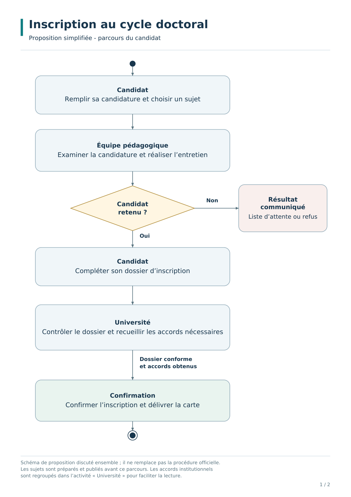
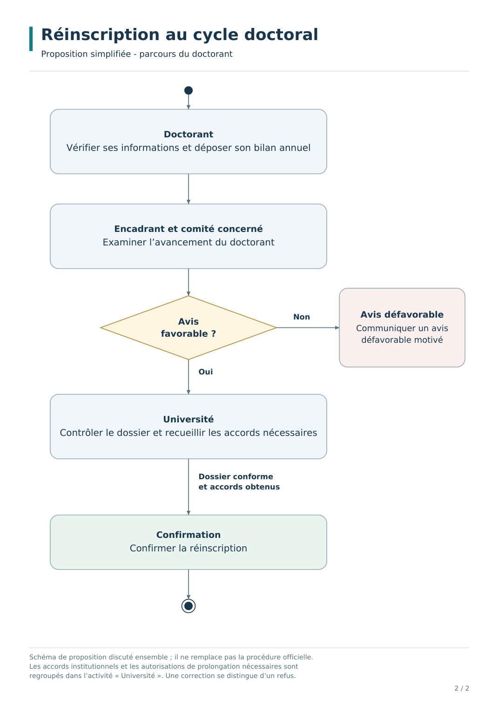

# Gestion du cycle doctoral — Atelier O&M Développement Logiciel

**Étudiant :** Hamza Tazi  
**Compte GitHub :** [Hamza-Tazi-212](https://github.com/Hamza-Tazi-212)  
**Dernière mise à jour :** 12 novembre 2026 
**État :** TP de la séance 5 terminé. Projet Laravel GCD+ initialisé en local.

## Objectif

Étudier les procédures d’inscription et de réinscription au cycle doctoral et représenter leur déroulement à l’aide de diagrammes d’activités.

## Documents à consulter

| Document | Contenu |
| --- | --- |
| [Diagrammes issus de l’analyse des documents](docs/diagrammes/diagrammes-analyse-documents.pdf) | Version détaillée construite à partir des PDF et captures fournis pour l’atelier, avec références. |
| [Diagrammes de la proposition simplifiée](docs/diagrammes/diagrammes-proposition-simplifiee.pdf) | Proposition d’organisation plus simple : un diagramme par page. |
| [Inscription — version modifiable](docs/diagrammes/inscription.md) | Diagramme en Mermaid et périmètre de la proposition. |
| [Réinscription — version modifiable](docs/diagrammes/reinscription.md) | Diagramme en Mermaid et périmètre de la proposition. |
| [Suivi de l’avancement](docs/avancement.md) | Travaux réalisés, points à discuter et prochaines étapes. |
| [TP de la séance 5](docs/tp-seance-5/README.md) | Trois diagrammes UML et règles de gestion des candidatures. |
| [Tableau comparatif GCD](docs/tableau-comparatif-gcd.pdf) | Pistes d’amélioration discutées en atelier. |

## Parcours candidat confirmé pour GCD+

L’accueil présente les sujets publiés sans connexion. Le visiteur peut les ajouter au panier, qui est conservé après connexion. L’envoi d’une candidature exige une connexion par e-mail. Chaque candidat peut postuler à trois sujets maximum par campagne, en comptant les candidatures déjà envoyées.

## Aperçu de la proposition simplifiée

### Inscription

### Réinscription

## Avancement

- [x] Lire les ressources et examiner les captures d’écran fournies.
- [x] Identifier les intervenants et les principales étapes.
- [x] Réaliser les deux diagrammes détaillés avec leurs références.
- [x] Préparer une proposition simplifiée des deux parcours.
- [x] Exporter les diagrammes en PDF.
- [x] Finaliser le TP de la séance 5 et ajouter le tableau comparatif.
- [ ] Présenter les propositions au professeur et recueillir ses observations.
- [ ] Corriger les diagrammes à partir des retours.
- [ ] Valider la version à retenir pour la suite du travail.

## Distinction entre les versions

La version détaillée restitue l’analyse des ressources fournies. La version simplifiée est une proposition de conception à discuter : elle regroupe certaines étapes et ne constitue pas une procédure officielle validée.

## Retour pédagogique attendu

Les remarques peuvent porter sur les responsabilités des acteurs, les décisions, les cas particuliers et le niveau de détail à retenir. Elles peuvent être consignées dans une issue GitHub ou communiquées pendant la séance.

## Mise à jour du travail

Après chaque séance : mettre à jour les fichiers concernés et le suivi d’avancement, puis enregistrer les changements avec un message de commit décrivant le travail effectué.
