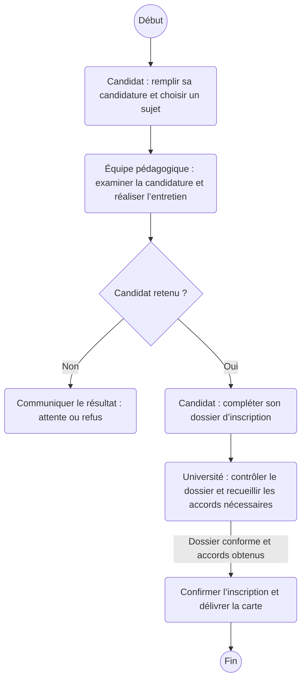

# Inscription au cycle doctoral

Proposition simplifiée, à discuter avec le professeur.

La préparation et la publication des sujets se déroulent en amont du parcours représenté.

La boîte « Université » regroupe les validations institutionnelles nécessaires. Le schéma ne remplace pas la procédure officielle.

[Consulter le PDF des deux diagrammes](diagrammes-proposition-simplifiee.pdf)
