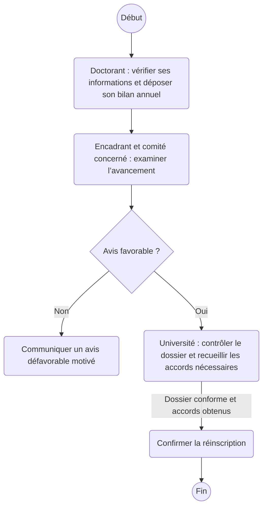

# Réinscription au cycle doctoral

Proposition simplifiée, à discuter avec le professeur.

Les autorisations de prolongation, lorsqu’elles sont requises, sont incluses dans le circuit des accords institutionnels.

La boîte « Université » regroupe les validations institutionnelles nécessaires. Le schéma ne remplace pas la procédure officielle.

[Consulter le PDF des deux diagrammes](diagrammes-proposition-simplifiee.pdf)
