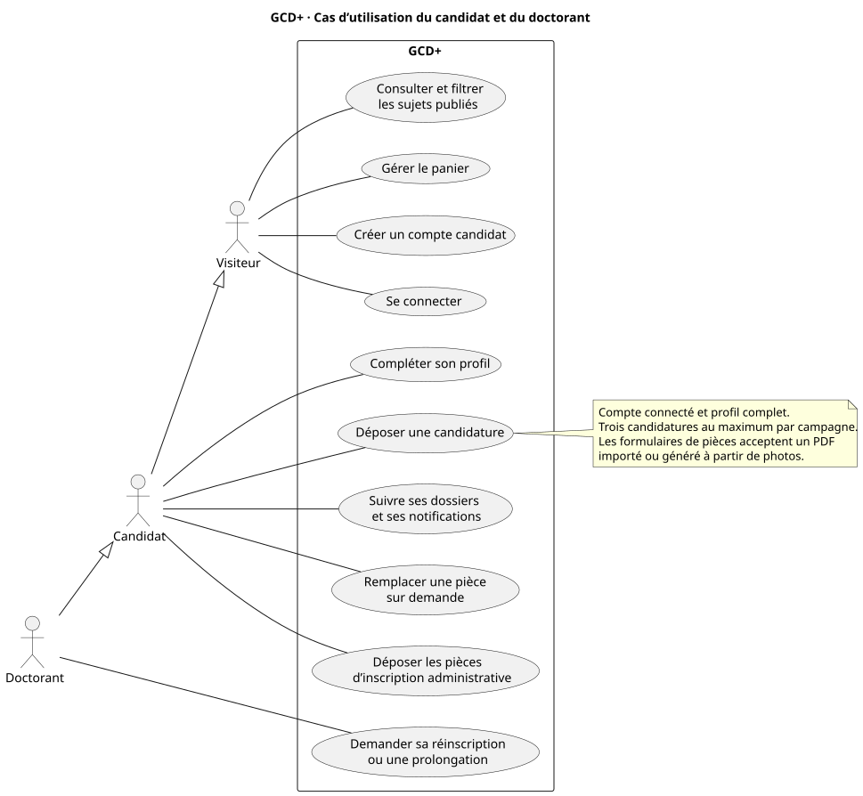

# Diagrammes de GCD+

Chaque diagramme dispose d’un aperçu SVG lisible sur GitHub et d’une source PlantUML modifiable. Les [diagrammes de conception du TP 5](../../tp-seance-5/README.md) sont aussi disponibles.

| Diagramme | Périmètre | Fichiers |
| --- | --- | --- |
| Cas d’utilisation du candidat et du doctorant | Catalogue, panier, compte, dossier et réinscription | [SVG](cas-utilisation-candidat.svg) · [PlantUML](cas-utilisation-candidat.puml) |
| Cas d’utilisation du personnel | Responsabilités et opérations accessibles par fonction | [SVG](cas-utilisation-personnel.svg) · [PlantUML](cas-utilisation-personnel.puml) |
| Classes métier | Principales classes et associations du code Laravel | [SVG](classes.svg) · [PlantUML](classes.puml) |
| Activité de candidature et d’inscription | Du catalogue public à l’inscription confirmée | [SVG](activite-candidature.svg) · [PlantUML](activite-candidature.puml) |
| Activité de réinscription | Bilan, compléments, avis, accords et décision | [SVG](activite-reinscription.svg) · [PlantUML](activite-reinscription.puml) |
| Séquence de dépôt | Navigateur, Laravel, base SQL et stockage des PDF | [SVG](sequence-candidature.svg) · [PlantUML](sequence-candidature.puml) |
| États de candidature | Transitions du parcours de sélection courant et confirmation administrative | [SVG](etats-candidature.svg) · [PlantUML](etats-candidature.puml) |
| États de réinscription | Instruction, corrections et décision | [SVG](etats-reinscription.svg) · [PlantUML](etats-reinscription.puml) |
| Architecture | Navigateur, Laravel, base SQL, stockage et courriels | [SVG](architecture.svg) · [PlantUML](architecture.puml) |

