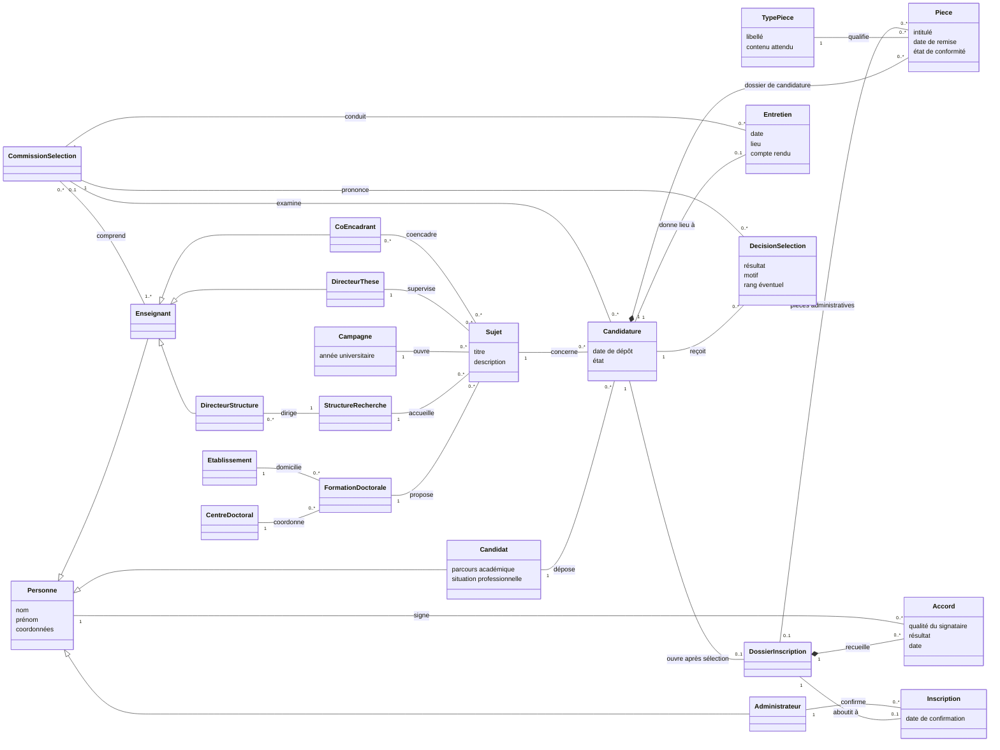
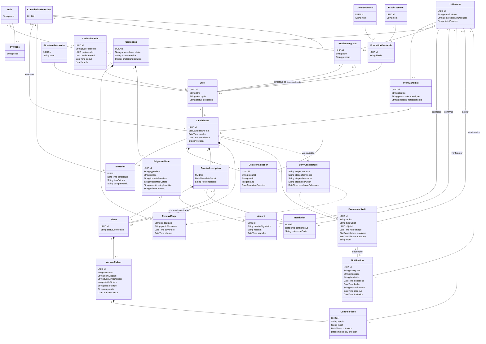
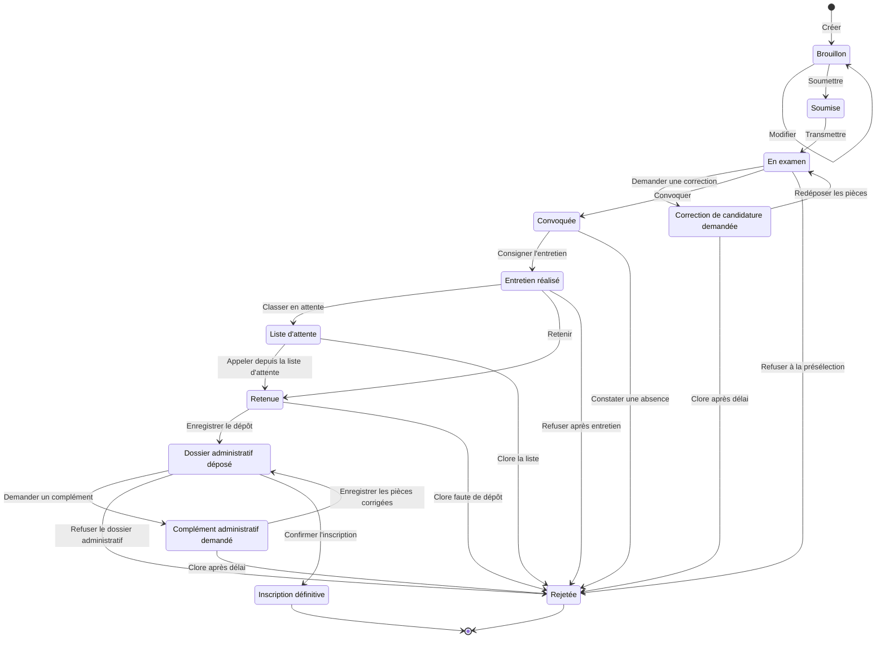

# TP séance 5 — Gestion du cycle doctoral

Le modèle couvre l'inscription initiale, de la candidature à l'inscription définitive. La réinscription concerne un doctorant déjà inscrit et relève d'un parcours distinct. Les diagrammes du dépôt donnent le déroulement proposé. Les ressources GCD décrivent la procédure actuelle. Le tableau comparatif inspire le suivi visuel et la correction ciblée des pièces.

## Parcours candidat confirmé pour GCD+

L’accueil présente les sujets publiés sans connexion. Le visiteur peut les ajouter au panier, qui est conservé après connexion. L’envoi d’une candidature exige une connexion par e-mail. Chaque candidat peut postuler à trois sujets maximum par campagne, en comptant les candidatures déjà envoyées.

Le [tableau comparatif](../tableau-comparatif-gcd.pdf) rassemble les autres pistes discutées en atelier.

## 1. Diagramme de classes conceptuel

Une candidature porte sur un seul sujet. Un candidat peut déposer plusieurs candidatures dans la limite de trois candidatures envoyées par campagne. Les spécialisations d'enseignant représentent des fonctions cumulables. Un dossier administratif est ouvert après sélection, y compris après promotion depuis la liste d'attente.

## 2. Diagramme de classes détaillé

### Règles d'implémentation

| Domaine | Règle |
|---|---|
| Comptes et droits | Compte actif requis pour agir. Les privilèges des rôles actifs se cumulent dans leur périmètre. Vérifier aussi la propriété du dossier, l'affectation au sujet, l'appartenance à la commission ou à l'établissement selon l'action. Le rôle d'administration des comptes ne confère pas le droit de décider d'une candidature. |
| Unicité et concurrence | Un dossier par couple candidat–sujet. La soumission exige un compte connecté par e-mail et vérifie le plafond de trois candidatures envoyées par campagne ainsi que la fenêtre applicable. Vérifier la version du dossier et verrouiller le quota du candidat pour la campagne dans la transaction de soumission. |
| Audit | Tracer création, modification, soumission, transmission, contrôles, décisions, accords et inscription. Journaliser l'acteur, l'action, l'objet, la date, le motif utile et les états avant/après. Une échéance automatique identifie le système comme auteur. Écrire la transition, l'événement et les notifications internes dans la même transaction. |
| Calendrier et progression | La campagne fournit les fenêtres de dépôt, de sélection et d'inscription, avec des créneaux distincts selon la liste si nécessaire. Le calendrier interactif ouvre le détail de chaque échéance. La chronologie du dossier utilise le journal pour afficher les étapes terminées, l'étape courante et les prochaines étapes applicables. Le statut et l'action sont affichés en texte en plus de leur repère visuel. |
| Notifications | Une convocation, une demande de correction ou une admission avec dossier à compléter crée une notification d'action pour le candidat. Une transmission crée une notification d'action pour la commission ou le service destinataire. La mise en attente, le rejet et la confirmation déclenchent une notification informative. La lecture est horodatée. Une action est traitée lorsque l'opération correspondante aboutit, ou expire à son échéance. |
| Pièces | Configurer par campagne et phase les types attendus, les formats, la taille maximale et les conditions, par exemple l'engagement de temps aménagé selon la situation. Contrôler le format détecté et la taille au dépôt, puis la lisibilité, la complétude et les signatures par le service habilité. États possibles : À vérifier, Conforme, À compléter, Non conforme. Un remplacement ajoute une version à la même pièce et ouvre un nouveau contrôle. Une décision de conformité porte sur la dernière version. |
| Dossier administratif | Enregistrer le dépôt papier et la référence du reçu lorsque la procédure le prévoit. Les accords exigés et l'établissement compétent dépendent du circuit applicable. La carte est délivrée après confirmation de l'inscription. |

## 3. Diagramme d'états-transitions

Les événements du diagramme utilisent les conditions et habilitations ci-dessous. Chaque événement est journalisé. Les clôtures pour échéance, l'absence à l'entretien et les demandes de correction sont des règles proposées à valider avec l'atelier.

| Événement | Acteur habilité et condition | Action |
|---|---|---|
| Créer, modifier | Candidat propriétaire, campagne ouverte et sujet publié à la création | Enregistrer le brouillon ou la nouvelle version. |
| Soumettre | Candidat propriétaire, fenêtre ouverte, quota disponible et pièces obligatoires présentes | Horodater le dépôt et notifier sa réception. |
| Transmettre | Gestionnaire habilité, dossier soumis et commission affectée | Affecter le dossier à la commission et lui notifier l'examen. |
| Demander une correction | Commission habilitée, pièce de candidature manquante ou non conforme et correction autorisée | Indiquer les pièces, le motif et le délai. Notifier le candidat. |
| Redéposer les pièces | Candidat propriétaire, demande ouverte et délai respecté | Ajouter les versions, repasser les pièces à vérifier et notifier la commission. |
| Convoquer | Directeur de thèse habilité sur le sujet, dossier présélectionné et créneau autorisé | Créer l'entretien et notifier le candidat avec les modalités. |
| Consigner l'entretien | Membre habilité de la commission, entretien tenu | Enregistrer le compte rendu. |
| Refuser à la présélection, constater une absence, refuser après entretien | Commission habilitée, respectivement critère de présélection non satisfait, absence constatée selon les règles de campagne, ou décision défavorable | Consigner le motif et notifier le candidat. |
| Classer en attente, retenir | Commission habilitée, décision consignée après entretien | Enregistrer le rang si applicable ou ouvrir le dossier administratif. Notifier le résultat. |
| Appeler depuis la liste d'attente | Gestionnaire habilité, place libérée, rang éligible et période applicable ouverte | Ouvrir le dossier administratif et notifier l'échéance. |
| Clore la liste, clore faute de dépôt | Gestionnaire habilité, liste officiellement close ou échéance de dépôt dépassée sans dossier enregistré | Enregistrer le motif de clôture et notifier le candidat. |
| Enregistrer le dépôt | Service de l'établissement, dossier reçu pendant le créneau applicable | Enregistrer la date et le reçu, puis déclencher le contrôle. |
| Demander un complément | Service de l'établissement, pièce administrative manquante ou non conforme et correction autorisée | Indiquer les pièces, le motif et le délai. Notifier le candidat. |
| Enregistrer les pièces corrigées | Service de l'établissement, pièces remises dans le délai applicable | Ajouter les versions et relancer le contrôle ciblé. |
| Clore après délai | Commission pour la candidature, service de l'établissement pour le dossier administratif. Délai expiré et demande non satisfaite | Consigner le motif et notifier le candidat. |
| Refuser le dossier administratif | Service de l'établissement, motif définitif établi selon les règles de campagne | Consigner le motif et notifier le candidat. |
| Confirmer l'inscription | Service de l'établissement, dernières versions conformes, dépôt enregistré et accords requis obtenus | Créer l'inscription, notifier la confirmation et rendre disponible la référence de carte lorsqu'elle est attribuée. |

## Références de travail

- Énoncé de la séance 5, TP O&M Développement Logiciel.
- Archive Ressources Atelier O&M Dev Logiciel, notamment le guide professeur, la procédure d'inscription administrative 2026–2027 et le calendrier de campagne.
- [Diagramme d'activités d'inscription du dépôt de l'atelier](https://github.com/Hamza-Tazi-212/atelier-gestion-cycle-doctoral/blob/main/docs/diagrammes/inscription.md).
- Tableau comparatif GCD, synthèse du débat USMBA. Idées retenues dans ce modèle : suivi de la prochaine action, calendrier interactif et remplacement ciblé d'une pièce.
